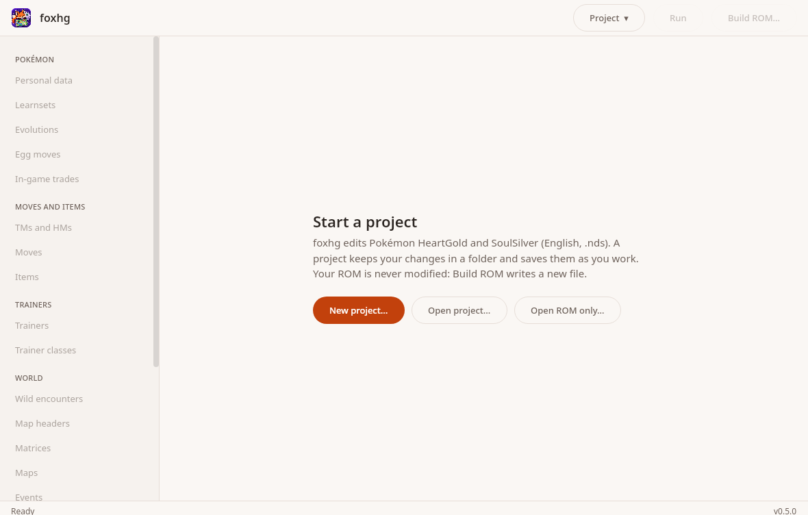
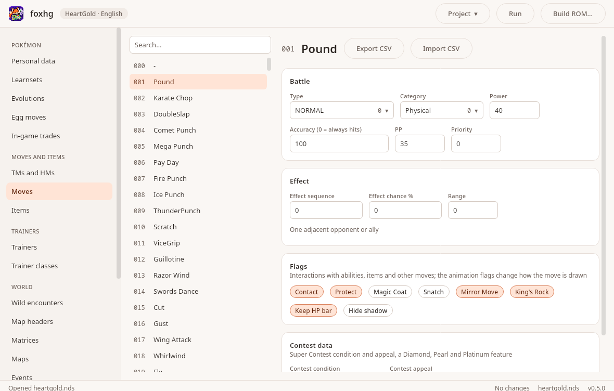
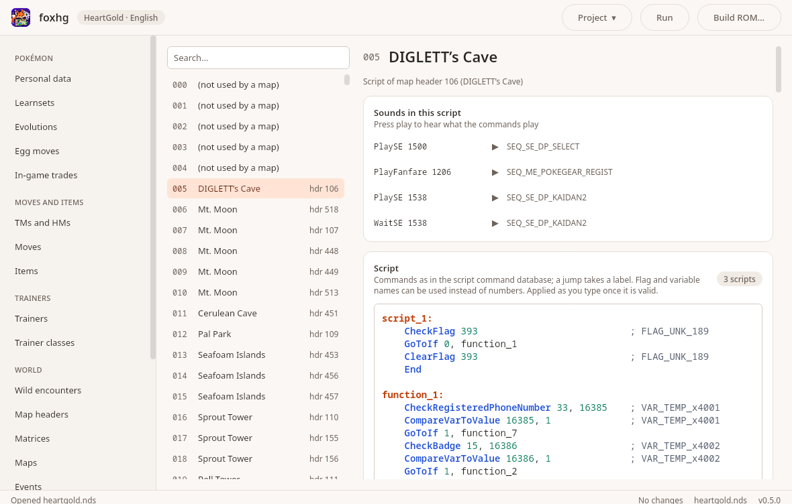
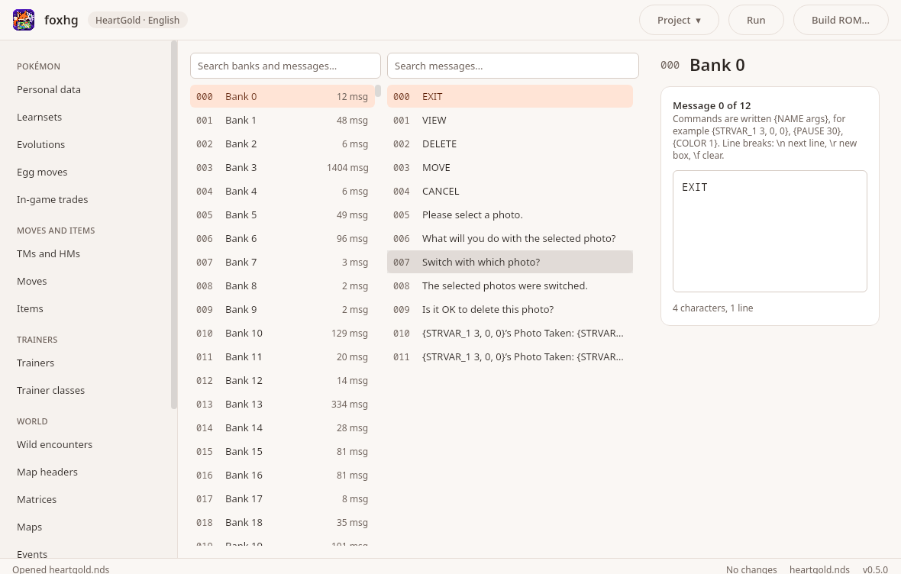
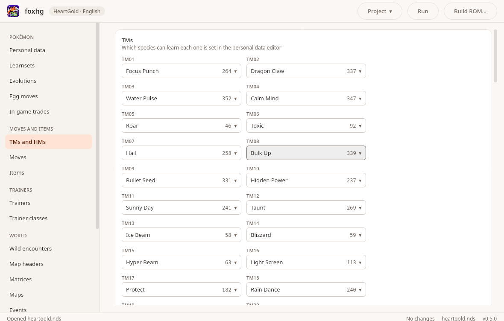

<div align="center">

# foxhg

**A native, cross-platform ROM editor for Pokémon HeartGold and SoulSilver.**
Edit Pokémon, moves, items, trainers, wild encounters, maps (in 3D), scripts, text and more - on Linux, Windows and macOS, no Wine required.

[](LICENSE)


[](https://buymeacoffee.com/legendaryredfox)



</div>

---

## What is foxhg?

[DSPRE](https://github.com/DS-Pokemon-Rom-Editor/DSPRE) is the go-to editor for Nintendo DS Pokémon ROMs, but it is a C# WinForms
app that only runs on Windows (or under Wine). **foxhg** has the same job, rebuilt from scratch in Kotlin Multiplatform with
Compose Multiplatform, so it runs natively everywhere. The format code lives in a UI-free library (`core`) and is tested against a real
ROM, byte for byte.

**Current target: Pokémon HeartGold (English).** SoulSilver (English) opens too where the layout is identical. Diamond, Pearl,
Platinum and other languages are out of scope until HeartGold is solid.

> **foxhg does not include any game data.** You need your own legally obtained ROM. No ROM, extracted file or sprite is ever stored in this
> repository (the screenshots show only text and numbers), and foxhg never modifies the ROM you open: *Build ROM* writes a new file.

## Screenshots

Text and numbers only: no sprites or maps, so nothing here is more than the values the editors show.

<table>
  <tr>
    <td><br><sub><b>Moves:</b> battle data, effect, flags, CSV import and export</sub></td>
    <td><br><sub><b>Scripts:</b> syntax highlighting, flag and variable names, sound preview</sub></td>
  </tr>
  <tr>
    <td><br><sub><b>Text archives:</b> every message bank, search, command codes</sub></td>
    <td><br><sub><b>TMs and HMs:</b> pick the move behind each disc</sub></td>
  </tr>
</table>

## Features

### Editors

| Area | Editors |
|------|---------|
| **Pokémon** | Personal data (base stats, EV yield, types, abilities, catch rate, growth, egg groups, wild held items, TM/HM compatibility), Learnsets, Evolutions, Egg moves, Starters (species, level, held item; the rival and the professor follow), In-game trades |
| **Moves and items** | Moves (battle data, flags, range, contest data), Items (CSV import and export for both), Hidden items, TMs and HMs |
| **Trainers** | Trainers (header, party with held items and custom moves, battle items, *replace a species in every party*), Trainer classes (gender, prize money) |
| **World** | Wild encounters (rates, grass by time of day, water and fishing slots, swarms, radio slots, copy from SoulSilver), Map headers (every field), Matrices, Maps, Events |
| **Scripts and text** | Scripts (a text language with syntax highlighting, flag, variable and message names, level scripts), Text archives (every message bank, search across all messages, bank names where known) |
| **Audio** | Sounds browser (SDAT sequences) with a built-in sequence player |
| **Tools** | Files: a read-only tree of the ROM with sizes, offsets, a hex dump and export |

### Map editing

- **2D map view:** tile types and collision, paint / fill / pick, and every event (NPCs, trainers, warps, triggers, signs) drawn on the map
  - select, drag, add, duplicate and remove them on the canvas.
- **3D map view:** terrain and buildings rendered with their real textures by a built-in software renderer (no GPU library). Turn, tilt,
  pan and zoom; click a building to select it; overlays for events, collision and the walking surface (BDHC).
- **Building editing:** add, move (click the ground in 3D), duplicate and remove buildings, pick a model from a browser of all 340 models
  with previews.
- **Matrix overview:** the whole overworld as one rendered picture.

### Pictures and sound everywhere

Pokémon icons (including eggs and forms), front and back battle sprites with a shiny switch, item icons, trainer class sprites, overworld
NPC sprites, map thumbnails and sound playback show up next to the ids wherever the app shows one.

### Workflow

- **Projects:** a project is a folder with *only your changes*. The ROM is never copied or modified. Autosave, recents, relink a moved ROM.
- **Undo and redo** (Ctrl+Z, Ctrl+Shift+Z) across all editors, kept when you close and reopen a project.
- **Build ROM** writes a new `.nds` (the previous file is kept as `.bak`); **Run** builds and starts your emulator.
- **Files screen, progress bars and a loading screen**, light and dark themes, keyboard navigation in every list (arrows, Ctrl+F), a confirmation before tools that change many records at once.

### Under the hood

- NDS container, NARC, overlays and ARM9 handled in pure Kotlin, including BLZ compression, so edited overlays and a replaced ARM9 are
  recompressed and rebuilt. An unedited build is byte-identical to the input.
- Parsers for personal data, learnsets, evolutions, trainers, encounters, map headers, matrices, maps, events, scripts, text, NSBMD / NSBTX /
  NCGR / NCLR / NCER graphics and the SDAT sound archive. **Every format has a round-trip test against the real ROM.**

## Install

### Download

Packaged builds will be published on the release page. Until then, build from source (below). Packages are built per operating system
(see [Packaging](#packaging)).

### Build from source

You need **JDK 26** (the project is pinned to it; [SDKMAN](https://sdkman.io) users: `sdk env` picks it from `.sdkmanrc`) and nothing else -
Gradle comes with the wrapper.

```bash
git clone https://github.com/legendaryredfox/foxhg.git
cd foxhg
./gradlew :app:run                 # launch the app
```

Open your ROM with **Project ▾ → Open ROM without a project…**, or start a project with **New project…** (recommended: it saves your
work as you go).

```bash
./gradlew :core:jvmTest            # format and model tests, no UI
./gradlew build                    # everything, including the UI tests (needs a display)
```

## Using foxhg

1. **New project…** → pick your ROM and a folder. foxhg keeps only the files you change in that folder.
2. Pick an editor in the sidebar and change things. Edits are saved automatically; **Ctrl+Z** undoes.
3. **Build ROM…** writes a patched `.nds`. **Run** builds into a temporary file and launches your emulator.

### Run and your emulator

Set the command in **Project ▾ → Settings…**; `{rom}` marks where the ROM path goes (it is appended when missing):

```text
desmume {rom}
melonDS {rom}
retroarch -L /usr/lib/x86_64-linux-gnu/libretro/desmume_libretro.so {rom}
```

An emulator on your `PATH` is detected the first time. Settings live in `~/.config/foxhg/settings.properties`.

### Keyboard shortcuts

| Shortcut | Action |
|----------|--------|
| Ctrl+N / Ctrl+O / Ctrl+Shift+O | New project / open project / open a ROM without a project |
| Ctrl+S | Save (and write the undo history) |
| Ctrl+B / Ctrl+R | Build ROM / Run |
| Ctrl+Z / Ctrl+Shift+Z or Ctrl+Y | Undo / redo |
| Ctrl+F | Focus the search box of the list on screen |
| ↑ ↓ PgUp PgDn | Move through a list |
| 3D view: drag / right drag / Ctrl+wheel | Turn and tilt / pan / zoom |

(On macOS use ⌘ instead of Ctrl.)

## How it works

```
foxhg/
├── core/    Kotlin Multiplatform library, no UI: NDS container, NARC, overlays, text, graphics,
│            sound and one package per ROM data type. File and OS access only in jvmMain.
├── app/     Compose Multiplatform desktop app: one screen per editor, state in view models
│            that depend only on core.
├── docs/    spec.md, plan.md and formats.md (every offset and quirk confirmed on the real ROM).
└── scripts/ screenshot, live click test and emulator boot test helpers; table generators.
```

- **Edits are an overlay.** `RomProject` holds your changed files on top of the untouched ROM; *Build* applies them. Editors read through
  the project, so they always see their own unsaved edits.
- **Parse → edit immutable data → serialize.** Each format is an immutable data class with `parse(bytes)` and `toBytes()`, and a test that
  proves `parse` then `serialize` reproduces the original bytes for every entry of the ROM.
- **Documented.** [`docs/formats.md`](docs/formats.md) records each address, offset and quirk found while porting, including how
  the 3D map data (NSBMD, BDHC) is laid out.

### Testing

- Format tests run against `roms/heartgold.nds` (a symlink you create; gitignored). Without the ROM they **skip with a notice**, so a fresh
  clone and CI still build. `FOXHG_REQUIRE_ROM=1` makes a missing ROM fail instead.
- UI tests use Compose UI test against the real window content and the real ROM, driving the widgets (clicks, typing, drags). Run them under a
  display: `env -u XDG_CURRENT_DESKTOP -u DESKTOP_SESSION -u GNOME_DESKTOP_SESSION_ID xvfb-run -a ./gradlew build`.
- `scripts/live-click-test.sh` runs the real app under xvfb and drives it with real X mouse and keyboard events.
- `scripts/boot-test.sh` boots a built ROM headless in RetroArch + DeSmuME to check that edits still reach the title screen.

### Packaging

Native installers come from `jpackage` and can only be built **on the operating system they target**:

| Target | Command | Built on |
|--------|---------|----------|
| Debian / Ubuntu | `./gradlew :app:packageDeb` | Linux |
| Windows installer | `./gradlew :app:packageMsi` | Windows (needs WiX) |
| macOS disk image | `./gradlew :app:packageDmg` | macOS |

The `.deb` is built and its launcher is checked on Linux; the Windows and macOS packages have not been built yet.

## Status and roadmap

foxhg is **alpha**. HeartGold (English) is the focus and most editors cover the whole data they edit, but not everything is verified in the
game itself. Things that are known not to be done or not checked are marked in [`docs/plan.md`](docs/plan.md), for example:

- 3D map editing is staged: the viewer, building editing and walking-surface display work; lighting, shadows, water animation, sloped
  surface plates, rotation and scale, and writing new models are still to do.
- Sound playback is checked for length and level, not yet by ear; some SDAT features (streams, portamento, sweeps) are skipped.
- Not yet: Rock Smash and Fly editors, the overlay editor and ARM9 patch toolbox, SoulSilver-only encounter extras,
  replacing the ARM7 and the banner, other Pokémon games.

Spec: [`docs/spec.md`](docs/spec.md) · Plan and status: [`docs/plan.md`](docs/plan.md)

## Contributing

Issues and pull requests are welcome. Before you start on a format:

1. Read how the reference projects do it, then the format page, then write your own code from the format description - **do not copy code**
   from DSPRE (AGPL-3.0), ndspy (GPL-3.0) or other projects; read them to understand a format and note what you confirm in `docs/formats.md`.
2. Write the parser together with its **round-trip test against the real ROM**.
3. `./gradlew build` must pass, and never commit a ROM or anything extracted from one.

Look at the surrounding code first: one class per file type, immutable data classes, `core` free of Compose and AWT.

## Acknowledgements

foxhg stands on the shoulders of the DS Pokémon hacking community. Thank you to:

- [DSPRE](https://github.com/DS-Pokemon-Rom-Editor/DSPRE) and its contributors, whose editor this one is modelled on;
- the [DS Pokémon Hacking documentation](https://ds-pokemon-hacking.github.io/) for the file format descriptions;
- [pret/pokeheartgold](https://github.com/pret/pokeheartgold), the HeartGold decompilation, for struct layouts, constants and tables;
- [scrcmd-database](https://github.com/DS-Pokemon-Rom-Editor/scrcmd-database) (MIT) for the script command database;
- [Pokémon DS Map Studio](https://github.com/Trifindo/Pokemon-DS-Map-Studio), [VSMaker2](https://github.com/Chvlkie/VSMaker2),
  [ndspy](https://github.com/RoadrunnerWMC/ndspy) and [Nds4j](https://github.com/turtleisaac/Nds4j) for documenting formats foxhg reads.

## Disclaimer

foxhg is a fan project and is not affiliated with or endorsed by Nintendo, Game Freak, Creatures Inc. or The Pokémon Company. Pokémon and
related names are trademarks of their owners. foxhg contains no copyrighted game data and does not help with obtaining it; use it only with
a ROM you own, and respect the law where you live.

## Support

If foxhg saves you time, you can buy me a coffee - it keeps the project going. ☕

[](https://buymeacoffee.com/legendaryredfox)

## License

foxhg is free software under the **[GNU General Public License v3.0 or later](LICENSE)** (`GPL-3.0-or-later`).

Why the GPL: this is a tool in an ecosystem built on copyleft tools (DSPRE is AGPL-3.0, ndspy and Nds4j are GPL-3.0). The GPL keeps foxhg and
every fork of it free for the community, is compatible with its dependencies (Kotlin, Compose Multiplatform and kotlinx are Apache-2.0)
and with the data it uses (the MIT script database), and lets anyone use, study, change and share it.

Copyright © 2026 legendaryredfox
